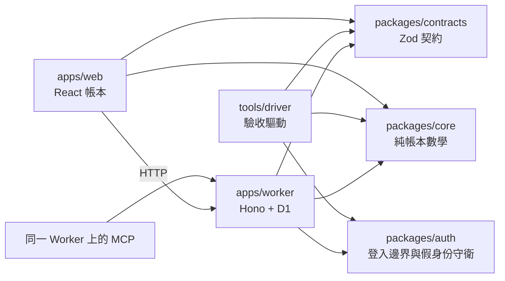

# 02 系統架構

## 元件

- `packages/core`：純函式。沒有 Workers、D1、檔案或網路。網頁預覽與 MCP 寫入都呼叫它，避免兩套分帳。
- `packages/contracts`：唯一可以定義 Zod schema 的地方。HTTP 與 MCP 共用。
- `packages/auth`：登入提供者介面，以及「假身份不得出現在正式設定」的純判斷。它不讀檔、不連 LINE。
- `apps/worker`：Hono 路由、Drizzle、D1、R2 收據儲存、MCP OAuth 2.1 Gateway（`@cloudflare/workers-oauth-provider` + KV）與服務層。切片 1 到 5 把分帳、虛擬成員、認領、結清與收款方式、多幣別換算、MCP 工具與收據附檔寫進 D1/R2。還沒做的路徑仍回 501。
- `apps/web`：帳本介面。不匯入 Worker、不碰 D1、不匯入 `@open-split/auth`（假登入不能進前端 bundle，也不能進 LIFF）。
- `tools/driver`：代理人與 CI 用來跑「登入 → 建群 → 記帳 → 分享連結 → 多幣別 → MCP OAuth 與 R2 收據」的本機驅動。狀態檔只記工作階段，帳在 D1。

依賴方向由 dependency-cruiser 檢查。違反時的說明在 `.dependency-cruiser.cjs` 的 `comment`。

## 請求怎麼走

網頁與 MCP 都進 Worker 的服務層。服務層做三件事：用契約解析輸入、問資料層這個人是不是群組成員、呼叫 `packages/core` 得到份額、外幣折算與餘額，再把結果寫進 D1。活動紀錄記的是服務層認可的結果，不是客戶端自己算的數字；`activity_log` 同時記錄操作者與管道（`via: "web" | "mcp"`、`clientId`）。

瀏覽器的即時預覽呼叫 `@open-split/core`。送出時仍以伺服器算出的結果為準。

## 登入與 MCP 是兩條線

LINE Login 是主要登入，開放給所有人。Google 是次要登入。兩者只建立 `users` 與 `auth_identities`，**不**打開 MCP。

MCP 走獨立的 OAuth 2.1（PKCE S256 + RFC 7591 動態註冊 + RFC 9728 / 8414 metadata），使用 `@cloudflare/workers-oauth-provider` 管理權杖與 KV 狀態；正式環境向上游驗證 Google OIDC ID token（`jose` RS256 JWKS），並核對環境變數 `MCP_ALLOWED_EMAILS` Gmail 白名單與 `users.mcp_allowed`，才核發 `mcp:read` / `mcp:write` 權杖；本機測試可透過 dev 同意頁完成相同授權與白名單檢查，服務層另行確認群組成員資格。見 [ADR-0003](adr/0003-auth-separation.md) 與 [ADR-0007](adr/0007-mcp-oauth-google-whitelist.md)。切片 6 會把上游從 Google 換成網頁同一個 LINE Login，改由 `users.mcp_allowed` 與 `OWNER_LINE_USER_IDS` 決定，見 [ADR-0009](adr/0009-mcp-identity-via-line.md)。

LIFF 使用打開它的那個人的 LINE 身份。在 LIFF 裡記帳就是在用帳本網頁。見 [ADR-0005](adr/0005-line-liff.md)。

## 本機假身份

驗收不能依賴真的 LINE 帳號。`@open-split/auth` 定義 `DevIdentityProvider.signInAs(name)`。`alice` 與 `bob` 的 subject 是固定的。

這個能力只在 `ENVIRONMENT` 為 `development` 或 `test`，且 `AUTH_DEV_IDENTITIES` 為真時成立。正式、預覽、空字串都會拒絕。

- `wrangler.jsonc` 的頂層 `vars` 是 `wrangler deploy` 會送出去的值，必須是 `ENVIRONMENT=production`、`AUTH_DEV_IDENTITIES=false`。任何環境把旗標打開，`pnpm test` 裡的設定檢查會失敗。
- 本機 `wrangler dev` 只從 `apps/worker/.dev.vars` 覆蓋。這個檔不進版控、不會上傳。範例在 `apps/worker/.dev.vars.example`，含測試用 LINE Login、MCP Gmail 白名單與 `COOKIE_ENCRYPTION_KEY`。
- driver 的 `login --as alice` 先在本機呼叫假身份提供者，所以 `--environment production` 在送出 HTTP 之前就會被同一個守衛拒絕。通過之後才向 Worker 換工作階段，帳本資料才進得了 D1。

真實 LINE Login 權杖交換與 LIFF SDK 屬於切片 6。

## 資料與儲存

- **D1** 是唯一的帳本關聯式資料庫，表結構在 `apps/worker/src/db/schema.ts`，說明在[程式設計](03-program-design.md)。金額欄位是整數最小貨幣單位，外幣換算採用兩個正整數比值（`fx_numerator` / `fx_denominator`），見 [ADR-0006](adr/0006-fx-conversion-and-rounding.md)。
- **OAUTH_KV** 由 `@cloudflare/workers-oauth-provider` 儲存 OAuth 客戶端與授權權杖狀態。
- **RECEIPTS_BUCKET (R2)** 保存僅供查閱（無 OCR）的收據二進位檔，採兩階段上傳（upload intent + magic bytes / SHA-256 驗證），並透過 Worker 授權路由以 `nosniff` 與 `sandbox` CSP 標頭私人下載，見 [ADR-0008](adr/0008-r2-receipt-attachments.md)。

遷移按切片加，目標資料表在 `apps/worker/migrations/0001_slice1.sql` 至 `0004_slice4_5.sql`。

## 可觀察性

Worker 打開 logs 與 traces。正式流量變大之後，再把 `traces.head_sampling_rate` 調低。日誌用 `JSON.stringify` 的單行物件。
